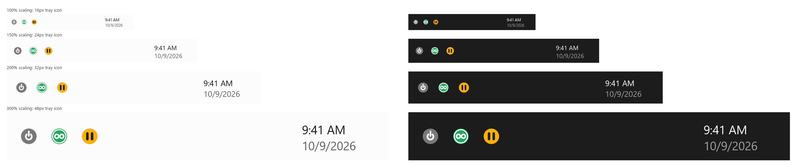
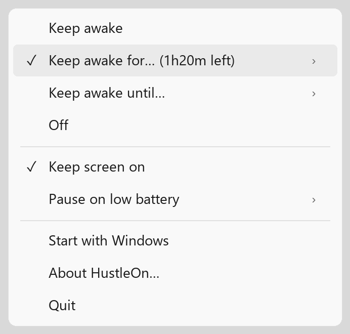
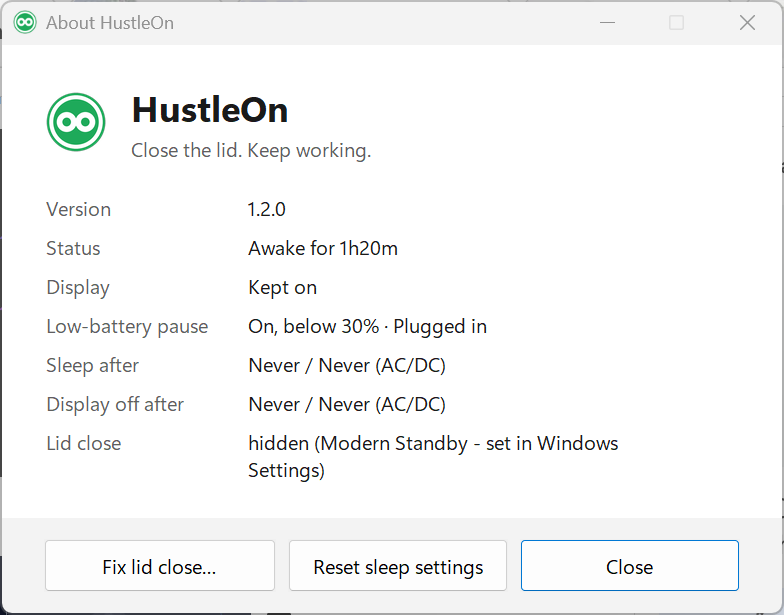

# HustleOn

**Close the lid. Keep working. Auto-stops before your battery pays for it.**

[](LICENSE)
[](#install)
[](pyproject.toml)
[](https://github.com/sheriffabdullah/hustle-on/releases)
[](https://github.com/sheriffabdullah/hustle-on/actions)

A small Windows tray app that keeps your laptop running with the lid closed, then puts your
sleep settings back when it stops. Caffeine-style keep-awake tools only stop idle sleep. Closing
the lid is a power-button action, so they do nothing. HustleOn handles both.



## Install

1. Download `hustle-on.exe` from [GitHub Releases](https://github.com/sheriffabdullah/hustle-on/releases).
2. Run it. It lives in the notification area (open the `^` overflow and drag it out to pin it).
3. Click the icon, pick **Keep awake**, **Keep awake for...** or **Keep awake until...**, then close the lid.

No admin rights needed day to day. winget and scoop packages are future work.

| Icon | Meaning |
|---|---|
| Gray power symbol | Off, normal Windows sleep |
| Green disc, white ring, infinity | Awake (indefinitely, timer or until) |
| Amber disc, dark bars | Paused because the battery is low |

State is shown by shape as well as colour. Icons are drawn at the real tray size for your display
scaling, so they stay sharp at 100-300%.

## How it works

- While keep-awake is on, HustleOn saves your lid, sleep, hibernate and display settings, sets them
  to Do Nothing / Never, and **restores them whenever it ends**: Off, timer expiry, low-battery pause, Quit.
- If the app or PC dies mid-session, the next launch restores them (`%APPDATA%\hustle-on\applied.json`).
- **Pause on low battery** (default 30%) restores your settings and lets the PC sleep instead of
  running on in a bag.
- Optional **Also stop when hot**: best effort, only works when Windows exposes a thermal sensor.
- Hover the icon for live status, for example `HustleOn: Awake for 1h20m · On battery 64% · Lid OK`.
- Optional **Start with Windows** toggle (off by default). Settings and `log.txt` live in `%APPDATA%\hustle-on`.

| Menu | About |
|---|---|
|  |  |

Dark mode is followed automatically (see `docs/*-dark.png`).

## Safety

- **Heat.** A closed laptop in a bag, sleeve or on a bed cannot shed heat. Do not leave it running there.
- **Bags.** Use a timer or Until, plug in when you can, and leave the low-battery pause on.
- **Modern Standby.** Some PCs hide the lid setting in Windows. Then the menu shows
  `Lid status unknown` and About has **Fix lid close...**, a one-time admin unlock. You can also set
  Settings > System > Power & battery > Lid controls > Do Nothing yourself. If a PC still
  sleeps on lid close, that is a firmware/Modern Standby limit HustleOn cannot override.

## How it compares

| | HustleOn | PowerToys Awake | Lidless | ClosedAwake |
|---|---|---|---|---|
| Lid-close handling | Yes (sets and restores the lid action) | No | Closest in approach | See its page |
| Modern Standby | Detects the hidden lid setting, one-time unlock | Fails on Modern Standby (per its issues) | See its page | See its page |
| Auto-stop on low battery | Yes, restores settings first | Not a goal | See its page | See its page |
| Distribution | GitHub Releases, MIT source | Part of PowerToys | See its page | Microsoft Store only |

Competitor notes come from our own research of their public pages and issue trackers and may be out
of date. PowerToys Awake is a fine idle-sleep tool. If Lidless fits you better, use it.

## Command line and development

```
python hustleon.py --check        # show lid/sleep/display settings
python hustleon.py --timer 60     # keep awake 60 min (Ctrl+C restores settings)
python hustleon.py --until 18:00
python hustleon_tray.py           # tray app from source: pip install -r requirements.txt
pip install -r requirements-dev.txt && python -m pytest   # powercfg, registry, battery are mocked
python icons/render_gallery.py && python docs/make_screenshots.py   # regenerate docs/ images
```

Build: `python -m PyInstaller --noconfirm hustle-on.spec`. The version lives only in
`pyproject.toml`. Specs are in `openspec/`. See [CHANGELOG.md](CHANGELOG.md). MIT, (c) Sheriff Abdullah.
